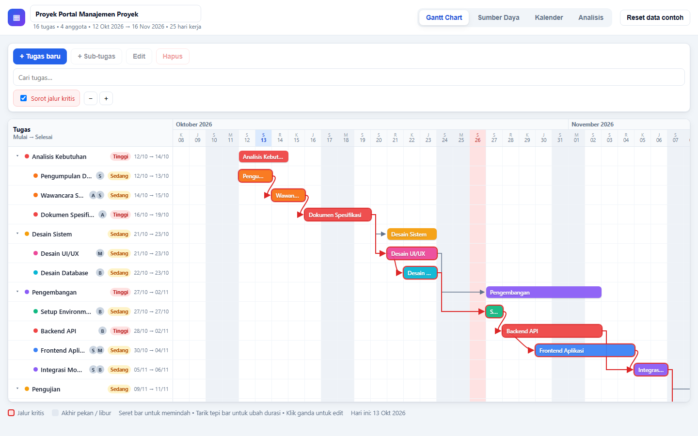
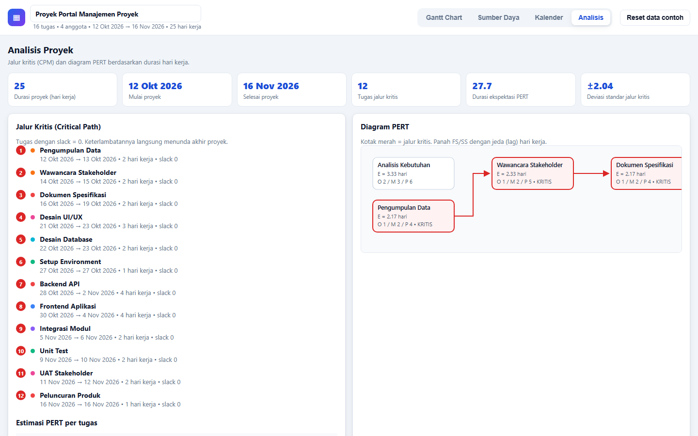

# Freebuff — Manajemen Proyek dengan Gantt Chart

Aplikasi manajemen proyek berbasis **Gantt Chart** yang berjalan sepenuhnya di browser.
Dibangun dengan **React + TypeScript + Vite**, data disimpan di `localStorage`.

## Tampilan Aplikasi

**1. Gantt Chart** — daftar tugas di kiri, bar tugas + panah dependensi di kanan:



**2. Analisis Proyek** — jalur kritis (Critical Path) dan diagram PERT:



> Screenshot diambil dengan Chrome headless pada resolusi 1440×900. Untuk membuat ulang:
> jalankan `npm run dev`, lalu `node scripts/screenshot.mjs` (hasil tersimpan di `docs/`).

## Fitur

1. **Task Management**
   - Tambah, edit, dan hapus tugas.
   - Durasi dihitung dalam **hari kerja**, tanggal mulai, prioritas (Low / Medium / High), dan warna indikator per tugas.
   - Struktur **sub-tugas (parent-child)** dengan expand/collapse.
2. **Predecessors & Timeline**
   - Hubungan antar tugas **Finish-to-Start (FS)** dan **Start-to-Start (SS)** beserta **jeda hari kerja (lag)**.
   - Visualisasi Gantt Chart: bar tugas, panah dependensi, **seret bar untuk memindah** dan **tarik tepi bar untuk mengubah durasi**.
3. **Resource Management**
   - Pendaftaran anggota tim: nama, email, peran, gaji.
   - Alokasi anggota ke tugas tertentu (lewat dialog edit tugas) beserta ringkasan beban kerja.
4. **Kalender Proyek**
   - Pengaturan hari akhir pekan (bisa diubah per hari).
   - Penambahan/hapus hari libur khusus, ditambah pratinjau kalender bulanan.
   - Semua perhitungan durasi **hanya menghitung hari kerja**.
5. **Analisis Proyek**
   - **Critical Path (CPM)**: forward/backward pass, slack, dan rantai jalur kritis.
   - **Diagram PERT**: estimasi tiga titik (O, M, P), nilai ekspektasi `E = (O + 4M + P) / 6`, variansi, deviasi standar, serta penandaan jalur kritis.

Data contoh (seed) tersedia sejak pertama kali dibuka, dan tombol **"Reset data contoh"** dapat mengembalikan data kapan saja.

## Kebutuhan

- Node.js **20.19+ atau 22.12+** (syarat Vite 8; dikembangkan dan diuji pada Node 22)
- npm 9+

## Instalasi

```bash
npm install
```

## Menjalankan (development)

```bash
npm run dev
```

Buka `http://localhost:5173` di browser.

## Build produksi

```bash
npm run build
npm run preview   # menjalankan hasil build secara lokal
```

Hasil build tersedia di folder `dist/`.

## Typecheck

```bash
npm run typecheck
```

## Menjalankan test

```bash
npm test              # sekali jalan (vitest run)
npm run test:watch    # mode watch
npm run test:coverage # laporan coverage
```

Test mencakup logika inti (kalender hari kerja, CPM/jalur kritis, PERT, storage) dan smoke test UI (CRUD tugas, anggota, kalender, analisis, serta drag/resize bar Gantt).

## Struktur proyek

```
├── chat-messages.json   # riwayat obrolan lengkap pembuatan aplikasi ini
├── docs/                # screenshot UI untuk README
├── scripts/             # utilitas (pengambil screenshot)
├── index.html
├── src/
│   ├── components/      # Gantt, modal tugas, panel sumber daya/kalender/analisis
│   ├── data/seed.ts     # Data contoh (seed)
│   ├── lib/
│   │   ├── calendar.ts  # Matematika hari kerja (weekend + libur)
│   │   ├── schedule.ts  # CPM: forward/backward pass + jalur kritis
│   │   ├── pert.ts      # Estimasi PERT dan diagram
│   │   └── storage.ts   # Persistensi localStorage + normalisasi data
│   ├── state/store.tsx  # Context global (state + aksi)
│   ├── __tests__/       # Test UI dan interaksi Gantt
│   ├── App.tsx          # Shell aplikasi & tab
│   └── styles.css       # Gaya global (responsif)
└── vite.config.ts       # Konfigurasi Vite + Vitest
```

## Catatan teknis

- Jadwal dihitung otomatis: `earliest start = max(tanggal mulai manual, batas predecessor FS/SS + lag)`.
- Tarik bar ke kiri hanya bisa sampai batas predecessor (aturan CPM), sehingga dependensi tidak pernah dilanggar.
- Data yang rusak/tidak lengkap di `localStorage` akan diabaikan dan diganti data seed, tanpa membuat aplikasi gagal.
- Tidak ada kredensial/rahasia di dalam proyek ini: seluruh data hanya ada di browser (localStorage) dan data contoh tertanam di kode.

## Riwayat pembuatan

`chat-messages.json` berisi riwayat obrolan lengkap proses pembuatan aplikasi ini (47 pesan),
termasuk isi lengkap setiap file proyek pada kondisi akhir di disk.
